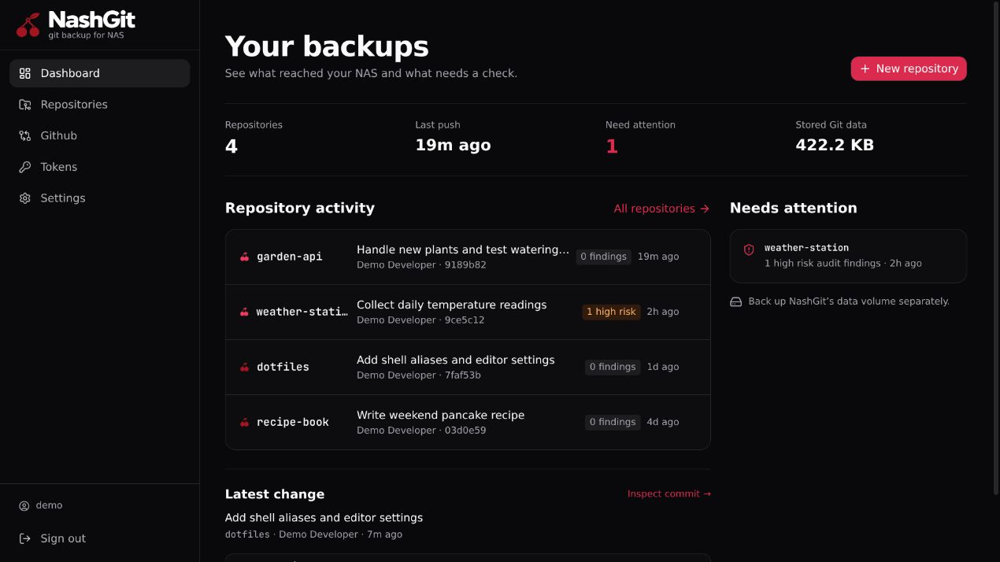
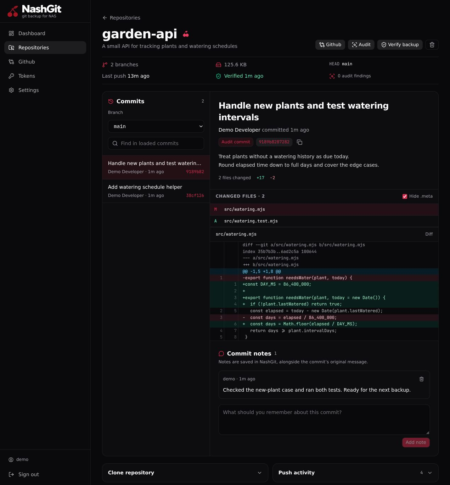
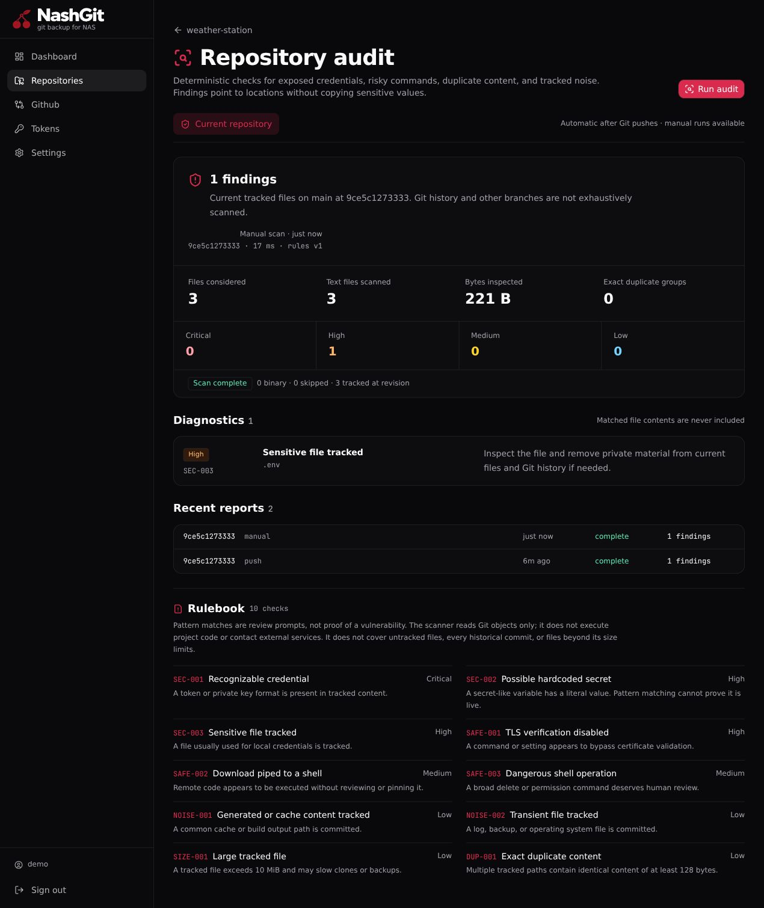
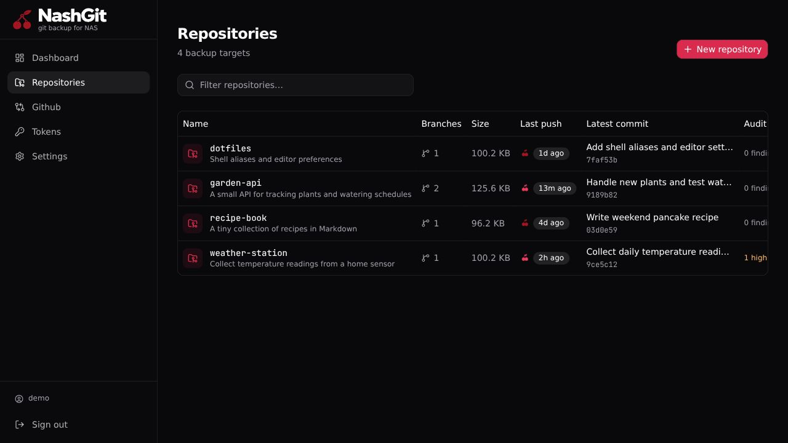
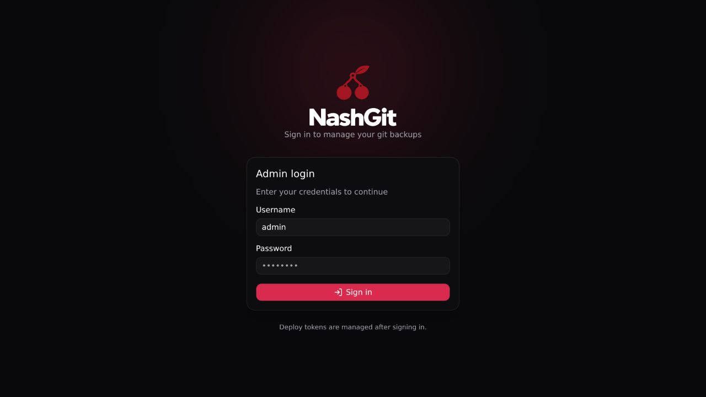
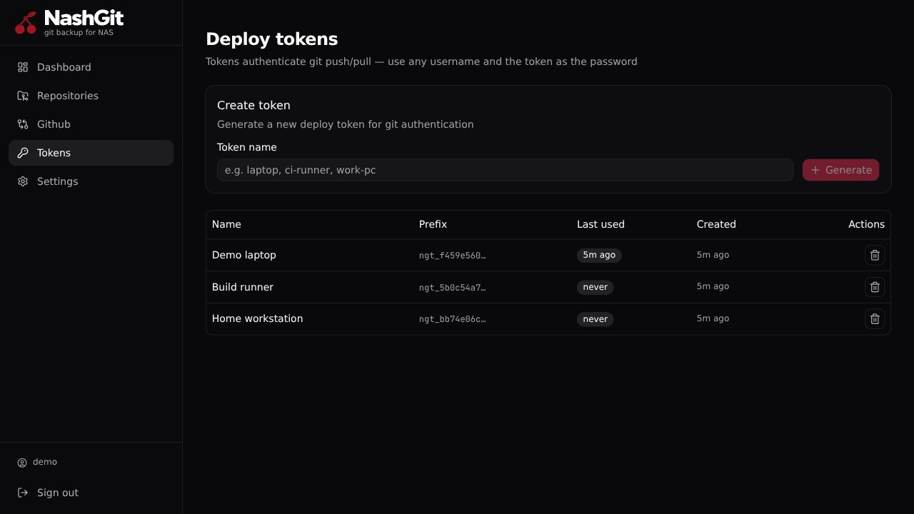

<div align="center">


<h1>
  <picture>
    <source media="(prefers-color-scheme: dark)" srcset="client/static/nashgit-wordmark-white.svg" />
    
  </picture>
</h1>

### A self-hosted Git remote for your NAS or home server

Store copies of your Git repositories on a machine you control. Create a repository
and deploy token in the web UI, then push with Git or the optional `nash` CLI.

[](https://github.com/ShAInyXYZ/NashGit/actions/workflows/ci.yml)
[](LICENSE)

[Features](#features) · [Quick start](#quick-start) · [Back up a project](#back-up-a-project) · [Security](#security) · [Development](#development)

</div>

## What NashGit backs up

NashGit stores the Git commits, branches, and tags you push. Pushes are manual unless
you arrange your own automation. It does not commit your working files for you.

Uncommitted changes, ignored files, remote-tracking branches you have not made local,
and submodule repositories are not included by `git push --all`. Git LFS object
storage is not implemented. Back up those separately when your projects need them.

The app runs in one container with an Express API, a static SvelteKit UI, system Git,
and SQLite metadata. The supplied Compose file keeps active repositories, trash,
and database files in `./data`. Back up this volume consistently; do not treat a
live directory copy as a complete backup. See [backup and restore](docs/BACKUP_RESTORE.md).

## Screenshots

Captured from a local instance with fictional projects and sample code. Backup ages
were seeded for the demo. The audit example deliberately tracks a non-secret `.env`
file to demonstrate a finding; these are not production repositories.



<details>
<summary>Commit explorer and audit reports</summary>

Browse commit messages, changed files, text diffs, and review notes:



Inspect the scope, coverage, and findings of an audit:



</details>

<details>
<summary>Repository list, login, and tokens</summary>





</details>

## Features

- **Git over HTTP:** push, fetch, pull, and clone using deploy tokens.
- **Branch protection:** the receive configuration rejects non-fast-forward branch
  updates and branch deletion. This is not immutable or ransomware-proof storage;
  an operator with filesystem access can still modify the data.
- **Trash and restore:** removed repositories move to a trash directory and can be
  restored with their metadata. Trash still consumes storage.
- **Integrity checks:** run `git fsck --strict --no-dangling` from the repository page.
  This checks stored Git objects; it does not prove you pushed every file or replace
  a restore test.
- **Commit explorer:** branch history, commit messages, file changes, text diffs,
  selected raster-image previews, and notes stored in SQLite.
- **Repository audits:** bounded pattern checks for possible secrets, risky commands,
  tracked noise, large files, and exact duplicates. Audits run after Git HTTP pushes
  or on request. They do not block a push, scan all history, or replace a security
  review. See the [rulebook and coverage limits](docs/AUDIT.md).
- **Local GitHub integration:** `npm run dev:local` can use the same machine's `gh`
  login to link a destination, create a private repository, and push the default
  branch without force. It does not sync tags or all branches, pull from GitHub,
  or run automatically. It is disabled in the supplied NAS container.
  See [GitHub integration](docs/GITHUB.md).
- **Single admin account:** revocable deploy tokens grant Git access to all active
  repositories. There are no separate users, repository-scoped tokens, or read-only roles.

## Quick start

You need Docker with Docker Compose and storage for the data volume. The current
publishing workflow builds the prebuilt image for `linux/amd64`; an ARM NAS may
require its own source build. ARM deployment has not been validated here.

Run these commands in a new deployment directory so you do not overwrite an existing
Compose file or environment file:

```bash
mkdir nashgit-deploy
cd nashgit-deploy
curl -fLO https://raw.githubusercontent.com/ShAInyXYZ/NashGit/main/docker-compose.yml
curl -fLO https://raw.githubusercontent.com/ShAInyXYZ/NashGit/main/.env.example
cp .env.example .env
```

Edit `.env` before starting:

- Set `NASHGIT_ADMIN_PASSWORD` to your initial admin password, or leave it blank to
  generate one at first startup.
- Set `NASHGIT_SECRET` to a stable random value, for example the output of
  `openssl rand -hex 32`.
- Choose `NASHGIT_BIND_ADDRESS`. The default `0.0.0.0` publishes port 3000 on every
  host interface. Use `127.0.0.1` for a proxy on the same host, or an appropriate
  private interface address for your setup.
- Set `NASHGIT_PUBLIC_URL` to the URL clients will use. If a reverse proxy terminates
  HTTPS, also configure `NASHGIT_TRUST_PROXY` as described under [Security](#security).

```bash
docker compose pull
docker compose up -d
```

Open `http://<nas-ip>:3000` only over a trusted, isolated connection, or use your
configured HTTPS URL. The initial username is `admin` unless configured otherwise.
If you left the password blank, read it locally from `docker compose logs nashgit`.
It is printed only when the account is first created; protect those logs.

Changing the seed password in `.env` does not change an existing account. Use
**Settings** after signing in. A password or username change invalidates existing
admin sessions.

The `latest` image follows `main` and may change. Pin an image digest if you need a
repeatable deployment. To build from source, clone this repository, comment out the
Compose `image:` line, uncomment `build: .`, and run `docker compose up -d --build`.
Back up the data volume before upgrading.

## Back up a project

Create a repository such as `my-project` and a deploy token in the web UI. Then, in
an existing local Git repository with commits:

```bash
# Replace nas.example with your configured server URL.
git remote add nas https://nas.example/git/my-project.git
git push nas --all
git push nas --tags
```

Use any username and the **deploy token** as the Git password. Do not embed the token
in a URL. If `nas` already exists, inspect its destination before changing it.
These two pushes are separate operations; check both results.

For subsequent backups, commit your work and repeat the pushes. `git push nas main`
pushes only `main`; substitute the branch you actually use. Divergent history needs
to be resolved locally because non-fast-forward branch updates are rejected.

To test a restore in a new directory:

```bash
git clone --branch main https://nas.example/git/my-project.git restored-project
```

Substitute an existing branch. New bare repositories initially point `HEAD` at
`main`; specifying `--branch` avoids relying on that default if you use another name.
A plain clone names its remote `origin`; the CLI's clone names it `nas`.

## The nash CLI

The optional CLI requires Node.js 20+ and Git. Install it from a checkout of this
repository, not from the Compose-only deployment directory:

```bash
npm install -g ./cli
nash login https://nas.example
```

`nash login` stores a deploy token and an admin session cookie in
`~/.config/nashgit/config.json`. This file is **plaintext**, with mode `0600` on
systems that honor POSIX permissions. The CLI supplies the token to Git through a
helper restricted to the configured server; newly created remote URLs have no token.
Old CLI-created remotes may still contain credentials and should be cleaned up.

| Command | Behavior |
|---|---|
| `nash create my-project` | Creates a server repository and adds or updates `nas` when run inside a local repository. |
| `nash backup` | Pushes all local branches, then tags, to `nas`. |
| `nash push` / `nash pull` | Pushes or pulls the current branch using `nas`. Pull modifies your local checkout. |
| `nash clone my-project` | Clones using the locally stored token, with remote name `nas`. |
| `nash list` | Lists repositories using the stored admin session. |
| `nash status` | Shows the server and token prefix. |
| `nash logout` | Removes local configuration; does **not** revoke the server token. |

Admin sessions expire after seven days and can be invalidated sooner. `nash list`
and `nash create` then require another login; token-based Git operations can continue
until the token is revoked. Each login creates another deploy token. Revoke unused
tokens in the UI. Revocation blocks new authentication attempts, not transfers
already in progress.

### Using NashGit with AI agents

The repository includes an optional [NashGit skill](skills/nashgit/SKILL.md) for
CLI usage and backup precautions. Install it into your agent's skills directory;
see [installation instructions](skills/README.md). The skill contains no credentials
and does not make backups run automatically.

## Security

- NashGit itself serves HTTP. Use HTTPS through a reverse proxy or an appropriately
  restricted encrypted network. HTTP Basic authentication does not encrypt tokens.
- Behind a TLS proxy, set `NASHGIT_TRUST_PROXY` to the trusted proxy IP/CIDR and have
  the proxy supply the correct forwarded protocol. This lets Express recognize HTTPS
  and mark session cookies `Secure`. Leave proxy trust unset for direct access; do
  not trust arbitrary forwarded headers. `NASHGIT_PUBLIC_URL` alone does not do this.
- Admin passwords and deploy tokens are bcrypt-hashed in the database. The CLI's
  local credentials and repository contents are not encrypted by NashGit.
- Every deploy token can read and write every active repository. Protect and revoke
  tokens accordingly. Login and Git requests have IP-based rate limits.
- Restrict network access explicitly. Installing Tailscale does not change Docker's
  published-port binding or automatically remove LAN/public exposure. Configure the
  bind address, firewall/access policy, and URL for your actual network. See the
  [remote access](docs/REMOTE_ACCESS.md) and [Tailscale](docs/TAILSCALE.md) guides.
- A Git backup is one copy of your history, not a complete disaster-recovery plan.
  Preserve an independent copy of the whole data volume. For a consistent offline
  backup, stop NashGit, copy the volume, then restart it. SQLite's online backup API
  alone does not coordinate a snapshot of the Git repositories.

The [2026-10-27 security review](docs/SECURITY_REVIEW_2026-10-27.md) records checks,
fixes, and remaining limitations at that point in time. It is not a guarantee that
a deployment is secure or has never been breached.

## Architecture

```text
Express (port 3000 in the supplied container)
├── /api/*       Admin APIs: auth, repositories, tokens, notes, audits, settings
├── /api/github  GitHub integration (opt-in local development only)
├── /git/*       Git smart HTTP via git http-backend
└── /*           Built SvelteKit SPA

/data
├── repos/       Active bare Git repositories
├── trash/       Recoverable removed repositories
├── nashgit.db   SQLite metadata
└── SQLite WAL/SHM files while the database is active
```

## Configuration

Compose reads `.env` for the variables it explicitly passes to the container.
When running Node directly, provide environment variables in the process environment;
the server does not load `.env` itself.

| Variable | Default | Meaning |
|---|---|---|
| `NASHGIT_ADMIN_PASSWORD` | Generated | Seeds the admin password only if no admin exists. |
| `NASHGIT_ADMIN_USERNAME` | `admin` | Seeds the initial username. |
| `NASHGIT_SECRET` | New random value per start | Signs session JWTs; use a stable random secret to preserve sessions across restarts. |
| `NASHGIT_PUBLIC_URL` | Request origin | Base URL displayed in clone instructions. |
| `NASHGIT_TRUST_PROXY` | Unset | Trusted reverse-proxy IP/CIDR. |
| `NASHGIT_BIND_ADDRESS` | `0.0.0.0` | Compose-only host interface for the published port. |
| `PORT` | `3000` | Server listener port. The supplied Compose file fixes internal and external ports at 3000; edit its mapping/environment to change them. |
| `NASHGIT_HOST` | `0.0.0.0` | Direct Node listener address; `dev:local` uses `127.0.0.1`. |
| `NASHGIT_DATA_DIR` | `../data` relative to process cwd | Data root; the container uses `/data`. |
| `NASHGIT_GITHUB_LOCAL_INTEGRATION` | Disabled | Set to `1` with a loopback `NASHGIT_HOST` to enable server-machine GitHub CLI access. `dev:local` sets this. |

## Development

Use Git, npm, and Node.js **22.12+ on the 22.x line, or Node.js 24+** for the full
client/server toolchain. The CLI's Node 20 minimum is not the same as the client
build tools' minimum. The Dockerfile uses Node 22.

From the repository root:

```bash
npm ci --prefix server
npm ci --prefix client
npm run dev:local
```

Open `http://127.0.0.1:5173`. Vite proxies `/api` and `/git` to the API on
`127.0.0.1:4300`. Generated login details are in `.local-dev/credentials.json`;
read that file privately. Demo/development data lives under `.local-dev/`, which
is excluded from Git and Docker builds. The standard local launcher also enables
GitHub integration using this machine's existing `gh` login. It does not deploy
or modify a NAS instance.

To import a local working tree's committed branches and tags into the development
instance while it is running:

```bash
npm run seed:local -- /path/to/project ProjectName
```

This creates or updates a local mirror without committing the source's working
files. It pushes directly to local repository storage, so it does not trigger the
Git HTTP route's automatic audits; use the UI to run an audit afterward.

Checks and builds:

```bash
npm run typecheck
npm test --prefix server
node --test cli/askpass.test.mjs
npm run build
```

`npm run build` produces `server/dist` and `client/build`; it does not copy the client
into the server's static directory. The Dockerfile performs that packaging step.
To serve a built client locally without Docker, copy `client/build` to
`server/public` (replacing an older generated copy if present), then run
`npm start --prefix server` with the desired environment variables.

## License

[MIT](LICENSE). Copyright © 2026 Mounir Belahbib and Shiny-Studio OÜ.
